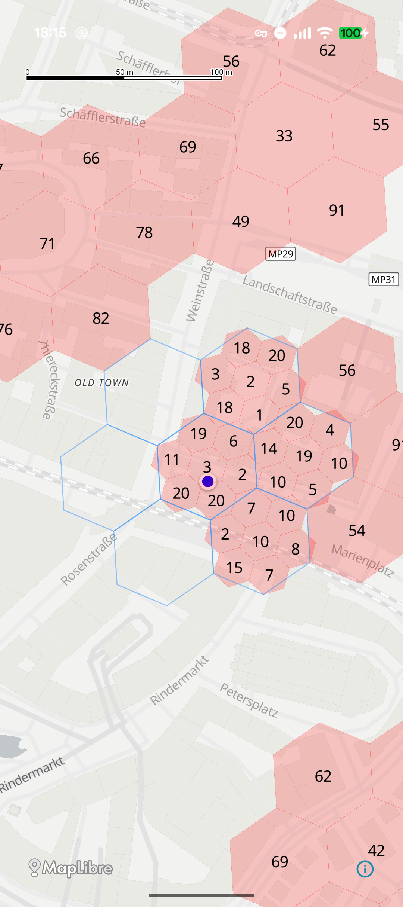
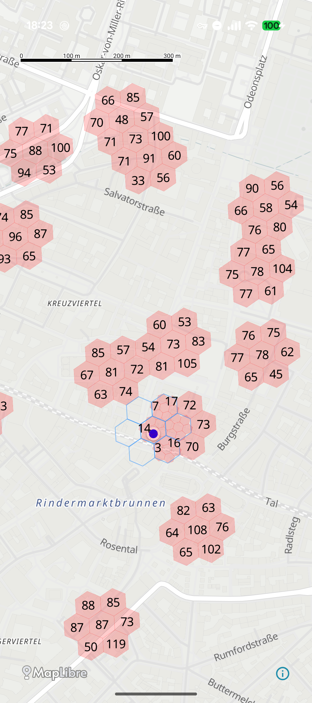
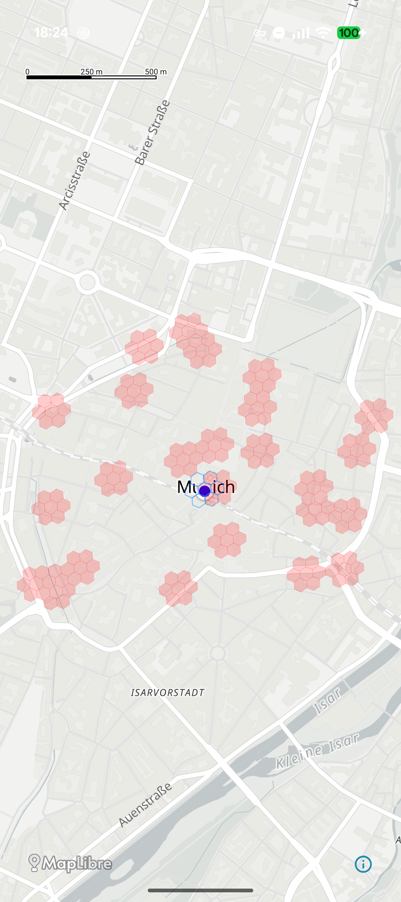
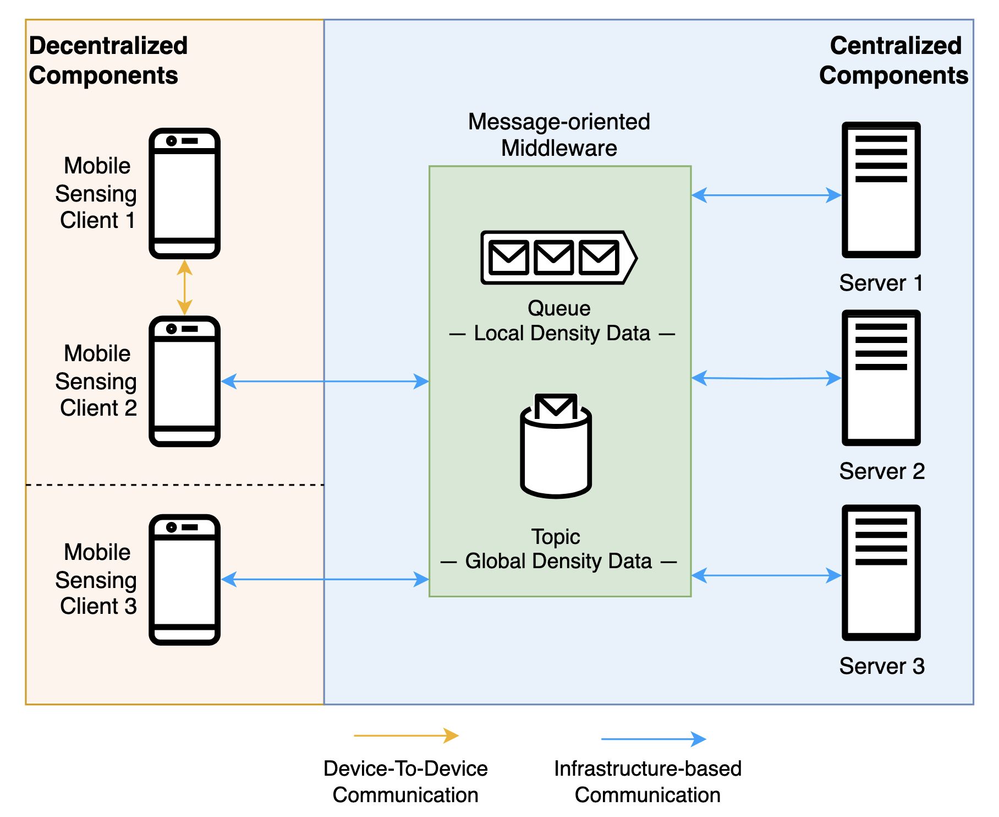

# Crowd Monitoring System

This project represents a concrete implementation of a crowd monitoring system designed to monitor crowd density. The system is based on a hybrid architecture that combines a centralized and a decentralized Mobile Crowd Sensing (MCS) approach. The incorporation of sensing devices, a Message-Oriented Middleware, and server instances as well as Device-To-Device (D2D) and infrastructure-based communication offers a fault tolerant, highly scalable, and ressource efficient approach to MCS.

The sensing process employed is based on the method proposed in the journal article "[Cellular Sidelink Enabled Decentralized Pedestrian Sensing](https://ieeexplore.ieee.org/document/10038666)". This method, developed by Stefan Schuhbäck, Lars Wischhof, and Jörg Ott, involves the usage of positional beacons and pedestrian measurement maps for the observation of the crowd density. 

## ✨ Features
* Utilization of smartphones as sensing devices  → no extra sensing hardware needed
* Sensing clients perform both data observing and processing and leverage Device-To-Device communication to share the data with nearby clients  → enhanced fault tolerance of the sensing application
* Dynamic ressource-based selection of edge clients to transmit locally sensed data representative for the group of proximate clients to the server  → ressource-preserving sensing process, as not each client has to establish costly infrastructure-based communication
* Message-Oriented Middleware for exchange of density data between clients and server  → enhanced scalability and less coupling
* Flexible environmental discretization utilizing Uber H3 for a resource efficient sensing and transmission process

## 🤖 Technologies
* Language: Kotlin
* Deployment and Orchestration: Android Application, Spring Boot, Docker, Kubernetes
* Communication and Data Exchange: Wi-Fi Aware, RabbitMQ
* Environmental Discretization & Visualization: Uber H3, MapLibre Compose

## 📸 Screenshots
The following screenshots show the visualization of the density data within the Android application running on the mobile sensing devices:
 
 
 &nbsp; &nbsp; 
 &nbsp; &nbsp;

## 🏗️ General Architecture and Repository Structure

In general the crowd monitoring system involves the following components:
* **Mobile Sensing Clients**: 
  * Responsibilities: Data observation, processing, transmission, and visualization
  * Communication Types: Connectionless D2D communication (Wi-Fi Aware), Infrastructure-based communication (only by the edge clients)
  * Deployment: Android application for deployment on physical sensing hardware ([mobileSensingClients](mobileSensingClients)), Spring Boot application incl. Docker & Docker-Compose file for locally deployment for testing purposes ([simulatedMobileSensingClients](simulatedMobileSensingClients))
* **Message-Oriented Middleware**:
  * Responsibilities: Data exchange between edge clients and servers (local density data from clients to servers; global density data from servers to clients & server)
  * Communication Types: Infrastructure-based communication
  * Deployment: RabbitMQ cluster via Kubernetes ([messageOrientedMiddleware](messageOrientedMiddleware))
* **Server**:
  * Responsibilities: Central aggregation of the data sensed by the clients into a single global view
  * Communication Types: Infrastructure-based communication
  * Deployment: Spring Boot Application incl. Docker file for deployment in Kubernetes ([server](server))

## 📁 Project  Structure
* [crowdDensityLibrary](crowdDensityLibrary): Implementation of the sensing process based on positional beacons and measurement maps according to "[Cellular Sidelink Enabled Decentralized Pedestrian Sensing](https://ieeexplore.ieee.org/document/10038666)". This library is required by the client implementation (both physical and simulated) and the server implementation.
* [messageOrientedMiddleware](messageOrientedMiddleware): Deployments files for operating the RabbitMQ cluster on Kubernetes. Includes the declaration of the RabbitMQ resources (exchanges, queues, ...), which are independent of existing conumser/producer.
* [mobileSensingClients](mobileSensingClients): Android application for the sensing client functionality.
* [server](server): Spring Boot application offering server functionality. Also provides Docker and Kubernetes files for operating the server in a Kubernetes cluster.
* [simulatedMobileSensingClients](simulatedMobileSensingClients): Spring Boot application serving as simulated sensing client. The purpose of a simulated sensing client is to introduce artificial measurements into the system in order to test the scalability capabilities of the system. This directory includes Docker and Docker-Compose files for locally deployment.

## ℹ️ Operational Details

The crowd density is determined by the sensing clients exchanging positional beacons on a frequent basis. These beacons are broadcasted in a connectionless manner leveraging the service discovery mechanism of Wi-Fi Aware. By counting the beacons received form nearby devices, the clients can generate a local perception of their environment. This is manged in measurement maps. The clients exchange these maps via connectionless broadcast with Wi-Fi Aware with nearby devices. By merging their own view of the environment with the view sent by other devices, the client can obtain an extended perception of the environment. Utilizing connectionless broadcast enables the crowd monitoring even in high mobility scenarios, as no connection establishment is needed.
\
For discretization the crowd monitoring system utilizes the Discrete Global Grid System Uber H3. The clients use a finer resolution to discretize their nearby environment than they do for more distant areas. This ensures that sensing clients can obtain, process, and visualize phenomena of interest in their direct environment with sufficient detail. Since observed values regarding more distant areas are not that relevant  to the clients, these areas can be discretized with a coarser resolution. In the case of the crowd monitoring system, for example, crowd density in the proximity of an individual
client is more relevant to that client than crowd density in areas kilometers away.
\
For each group of nearby clients, at most one client assumes the role of an edge client. This client exchanges representative for the group of nearby clients density data with the centralized components of the system via more costly infrastructure-based communication. The decision if to assume the role an edge client is performed during operation individually by each client on its own. This decision is based on the so called tranmission beenfit. This is influences by the available ressources (battery level, conncetion status) of the client. The transmission benefit represent the benfit to the crowd monitoring system and the nearby clients, of this particualr client exchanging density data with the backend.
\
The Message-Oriented Middleware enables the transmission of local density data from the edge clients to the server instances. Vice versa, the Message-Oriented Middleware also provides a communication channel for the server instances to send global density data to the edge clients and the other server instances, for synchronization purposes. The Message-Oriented Middleware is implemented with RabbitMQ and deployed on a Kubernetes cluster. For the exchange of the local density data a direct exchange with one bound queue is utilized. Each edge client serves as producer to this exchange. Each server instance registers as consumer to the queue. Consequently, the incoming local density data is processed by the server instances in a round-robin manner. For the transmission of the global density data a topic exchange is utilized. Each edge client and server instance is bound with an individual queue to this topic. Each time a server instance publishes a global density data message, this is delivered to each edge client and to each other server instance for synchronization purposes. For enhanced fault tolerance the RabbitMQ broker is realized by multiple connected nodes in a cluster manner.
\
The local denisty data sent by the edge clients is aggragated and processed into a single global view by the server instances. After a server instance processed the local density data sent by the edge clients into a single global view, this is sent to the edge clients and the other server instances for synchronization purposes via the Message-Oriented Middleware.

## 🛠️ Installation & Getting Started
* [crowdDensityLibrary](crowdDensityLibrary): This library is required for both client implementations and the server implementations to operate. The library can be built via the provided [gradle build script](crowdDensityLibrary/lib/build.gradle.kts).
* [messageOrientedMiddleware](messageOrientedMiddleware): For the operation of the RabbitMQ cluster Kubernetes files are provided. In addition, shell scripts are provided, handling the complete  deployment and shutdown process autonomously. The corresponding files can be found in the [messageOrientedMiddleware](messageOrientedMiddleware) directory.
* [mobileSensingClients](mobileSensingClients): The Android application is not prebuilt and has therefore to be compiled and packaged manually. The required gradle build scripts areincluded in the [mobileSensingClients](mobileSensingClients) directory.
* [server](server): This repository provides a [prebuilt docker image](https://github.com/leopoldBlk/crowd-monitoring-mcs-application/pkgs/container/server) for the server. Additionally, the directory [server](server) includes deployment files for operating the server instances on a Kubernetes cluster. Furthermore, shell scripts are provided, handling the complete  deployment and shutdown process autonomously. Before operation, make sure to specify the credentials required to connect to your RabbitMQ cluster.
* [simulatedMobileSensingClients](simulatedMobileSensingClients): This repository provides a [prebuilt docker image](https://github.com/leopoldBlk/crowd-monitoring-mcs-application/pkgs/container/simulated_mobile_sensing_client) for deployment of the simulated sensing clients. In addition, a Docker and Docker-Compose file is provided for the simulated clients under the directory [simulatedMobileSensingClients](simulatedMobileSensingClients). For the simulated clients being able to successfully connect to the RabbitMQ, make sure to specify the broker credentials.

## 📄 License
Licensed under the MIT License, Copyright (c) 2026 Leopold Bialek